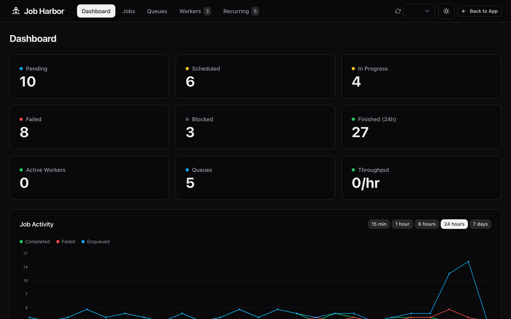
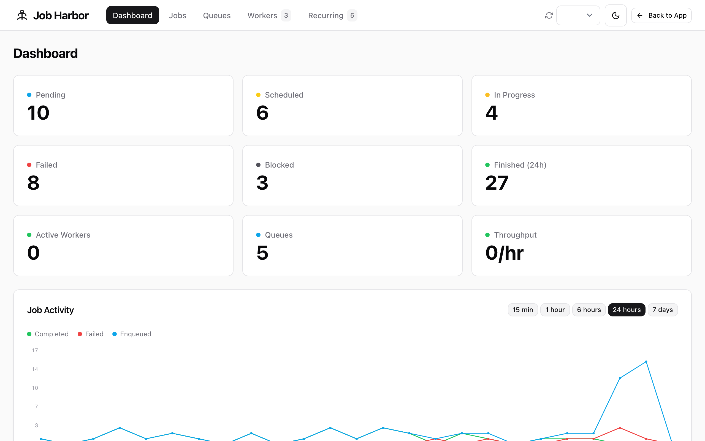
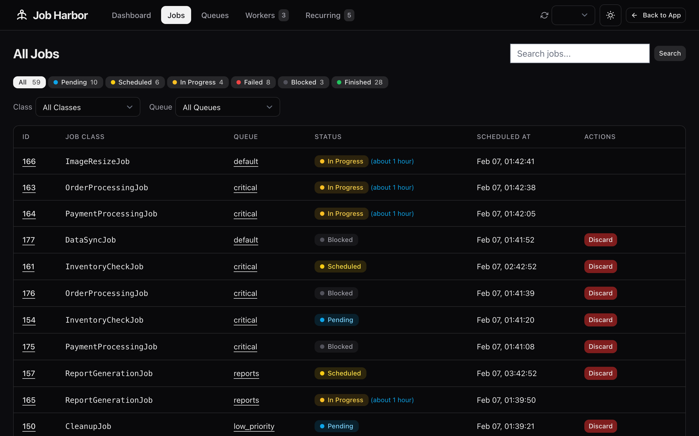
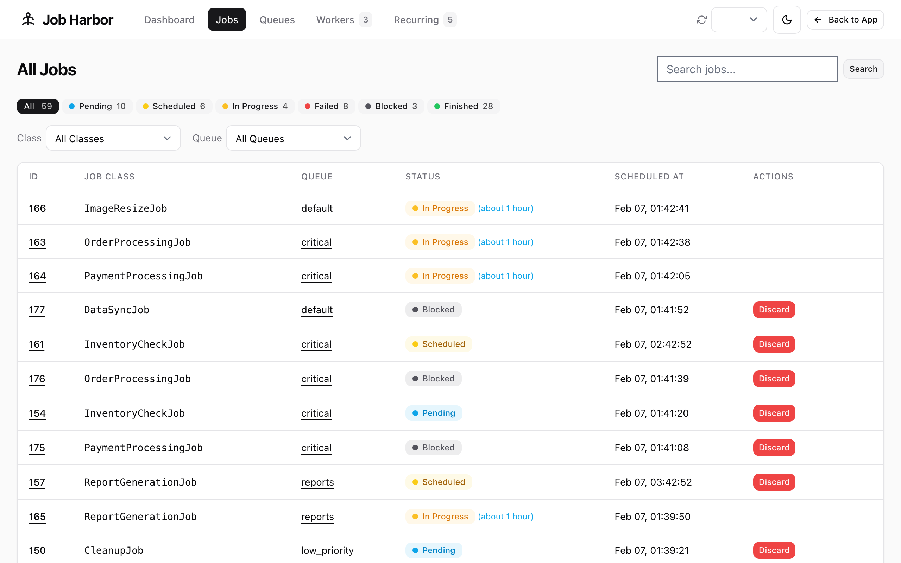
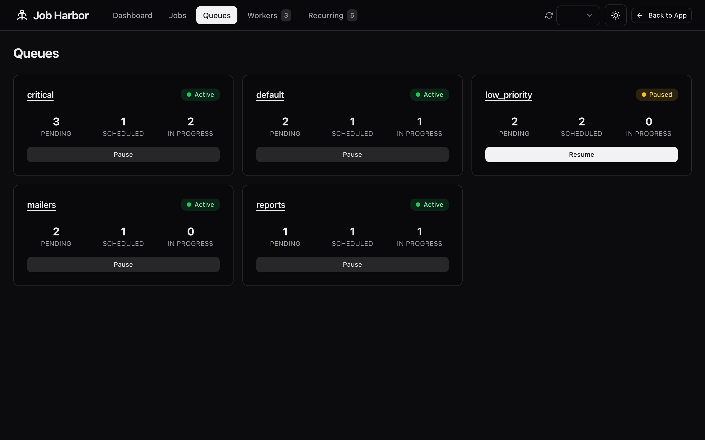
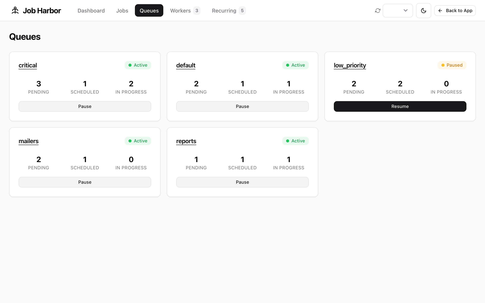
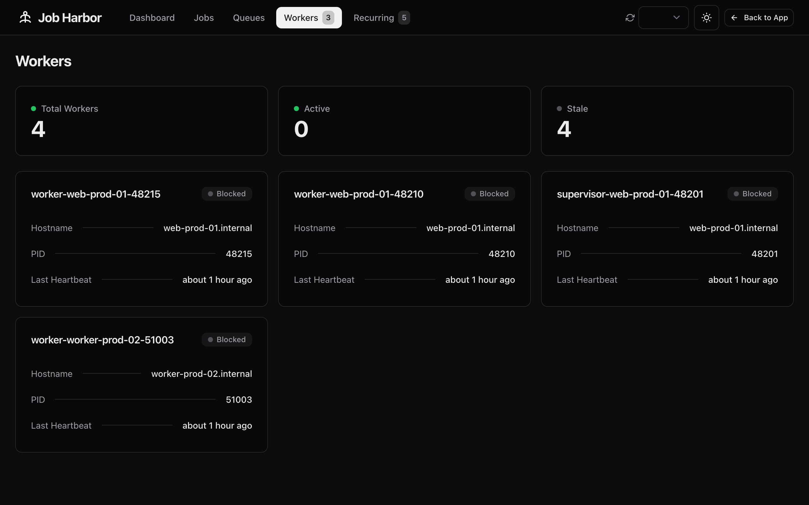
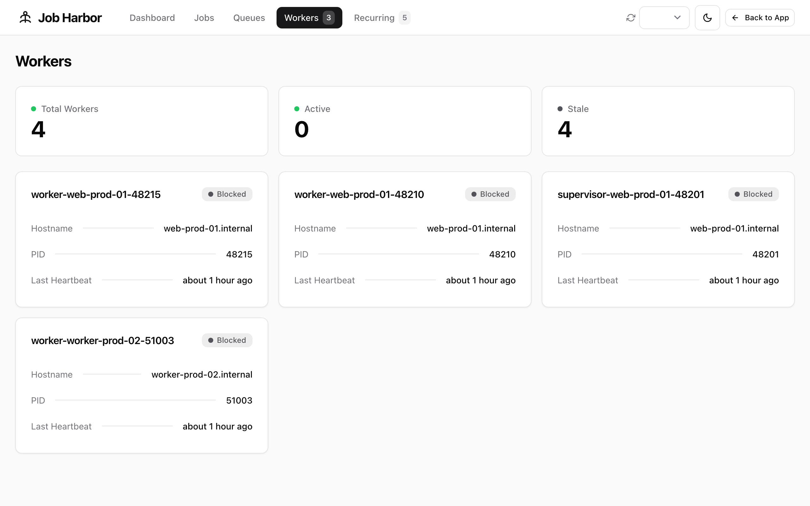
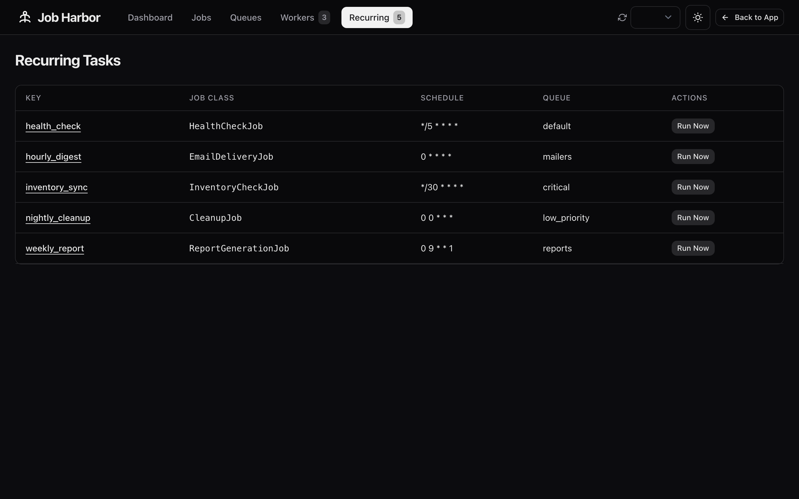
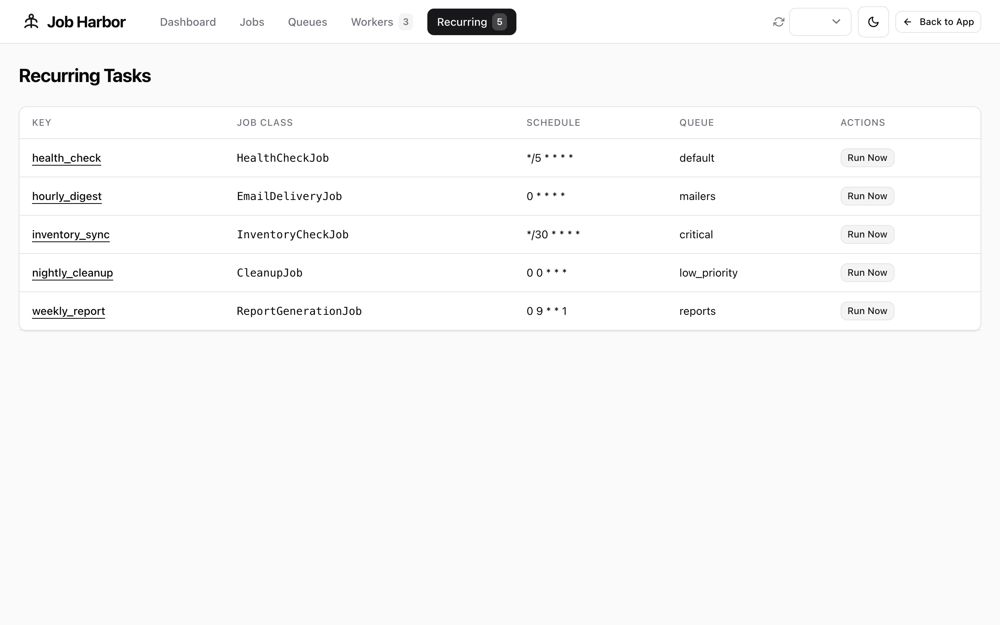

# Job Harbor

A modern, beautiful dashboard for monitoring and managing [Solid Queue](https://github.com/rails/solid_queue) jobs in Rails. Built with ViewComponents and a shadcn/ui-inspired design system.



## Features

- **Dashboard Overview** - Real-time statistics, job activity charts, failure rates, and recent failures at a glance
- **Job Management** - View, search, filter, retry, and discard jobs with full argument and error inspection
- **Queue Management** - Monitor queue health, pause and resume queues
- **Worker Monitoring** - Track active workers with heartbeat status and hostname details
- **Recurring Tasks** - View schedules and manually trigger recurring jobs
- **Auto-Refresh** - Configurable polling interval keeps data current
- **Dark/Light Themes** - Toggle between themes with localStorage persistence

## Screenshots

<details>
<summary>Dashboard</summary>

| Dark | Light |
|------|-------|
|  |  |

</details>

<details>
<summary>Jobs</summary>

| Dark | Light |
|------|-------|
|  |  |

</details>

<details>
<summary>Queues</summary>

| Dark | Light |
|------|-------|
|  |  |

</details>

<details>
<summary>Workers</summary>

| Dark | Light |
|------|-------|
|  |  |

</details>

<details>
<summary>Recurring Tasks</summary>

| Dark | Light |
|------|-------|
|  |  |

</details>

## Installation

Add to your Gemfile:

```ruby
gem "job_harbor"
```

Then run:

```bash
bundle install
```

## Mounting

Mount the engine in your routes:

```ruby
# config/routes.rb
Rails.application.routes.draw do
  mount JobHarbor::Engine, at: "/job_harbor"
end
```

Or with an authentication constraint:

```ruby
authenticated :user, ->(u) { u.admin? } do
  mount JobHarbor::Engine, at: "/admin/jobs"
end
```

## Configuration

Create an initializer at `config/initializers/job_harbor.rb`:

```ruby
JobHarbor.configure do |config|
  # Authorization - must return true to allow access.
  # Default: open in development and test, denied in every other environment until you set this.
  config.authorize_with = -> { current_user&.admin? }

  # Theme: :dark or :light (default: :dark)
  config.theme = :dark

  # Jobs per page (default: 25)
  config.jobs_per_page = 25

  # Auto-refresh polling interval in seconds (default: 30)
  # The selector offers Off, 15, 30, 60 and 300; any other value is added as its own option
  config.poll_interval = 30

  # Toggle features on/off
  config.enable_recurring_tasks = true   # default: true
  config.enable_real_time_updates = true # default: true (false removes auto-refresh entirely)
  config.enable_failure_stats = true     # default: true
  config.enable_charts = true            # default: true

  # Default chart time range (default: "24h")
  config.default_chart_range = "24h"

  # "Back to App" link in the navbar (default: nil, hidden)
  config.return_to_app_path = "/"
  config.return_to_app_label = "Back to App"

  # Also accepts a proc for dynamic paths:
  # config.return_to_app_path = -> { main_app.root_path }

  # Sensitive values (default: nil, use the app's config.filter_parameters)
  # An array replaces that list; false shows raw values and brings argument search back.
  config.filter_parameters = nil
end
```

### Sensitive values

Job arguments, the full payload and recurring task arguments are filtered with your app's
`config.filter_parameters`, read each time a page renders. Values under keys like `password` or
`token` show as `[FILTERED]`. Active Job's own `_aj_*` markers are left as they are.

While filtering is on, search matches job class, job ID and Active Job ID, but not argument
text: matching hidden values would let a search reveal them. Set `config.filter_parameters = false`
to show raw values and search arguments again.

Key filters don't redact free text or arguments passed positionally (not in a hash), because
those have no key. Error messages and backtraces are also shown as written. A Proc in
`filter_parameters` can scrub all of these by pattern; the dashboard runs it over positional
strings, error messages and backtraces too:

```ruby
Rails.application.config.filter_parameters << ->(_key, value) {
  value.gsub!(/\b(tok|sk)_live_\w+/, "[FILTERED]") if value.is_a?(String)
}
```

If a filter raises, the whole value shows as `[FILTERED]`.

`config.filter_parameters` accepts only `nil` (use the app's list), `false` (raw values) or an
Array of Strings, Symbols, Regexps and Procs (replaces the list). Anything else, including `true` or `[true]`, raises `ArgumentError` at boot so a
misconfiguration can't quietly show everything. An empty Array `[]` means "mask nothing": values
show raw and argument search comes back, the same as `false`.

Search queries you type appear in your request logs as the `q` parameter. Add `:q` to your app's
`filter_parameters` if searches may contain sensitive values.

## Authorization

**Production installs must configure `authorize_with`.** Until you do, the dashboard
denies every request in every environment except development and test (production,
staging, and so on) and logs a warning at boot. In development and test it stays open
so you can try it out without setup.

`authorize_with` is a lambda evaluated in the context of the dashboard controller
(`instance_exec`), so it can call your host app's helpers such as `current_user`. Return
a truthy value to allow the request. A rule you set explicitly is used as-is in every
environment, including `-> { true }` if you really want the dashboard open.

```ruby
# config/initializers/job_harbor.rb
JobHarbor.configure do |config|
  # Require an admin
  config.authorize_with = -> { current_user&.admin? }
end
```

### HTTP basic auth

```ruby
config.authorize_with = -> {
  authenticate_or_request_with_http_basic("Job Harbor") do |user, password|
    ActiveSupport::SecurityUtils.secure_compare(user, Rails.application.credentials.job_harbor_user!) &
      ActiveSupport::SecurityUtils.secure_compare(password, Rails.application.credentials.job_harbor_password!)
  end
}
```

The bang readers raise `KeyError` when a credential is missing, so an unset credential
can never be matched by empty basic-auth credentials.

### Devise

```ruby
config.authorize_with = -> {
  authenticate_user!
  current_user.admin?
}
```

### Rails 8 authentication generator

The dashboard inherits your `ApplicationController`, so the generated `Authentication`
concern already requires a session before this rule runs:

```ruby
config.authorize_with = -> { Current.user&.admin? }
```

The dashboard is an isolated engine, so the generated concern's bare
`redirect_to new_session_path` resolves against the engine's routes and raises
`ActionController::UrlGenerationError` for visitors without a session. Point it at the
host's routes instead, in your `Authentication` concern:

```ruby
def request_authentication
  session[:return_to_after_authenticating] = request.url
  redirect_to main_app.new_session_path
end
```

Or leave the concern alone and override it for the dashboard only:

```ruby
# config/initializers/job_harbor.rb
Rails.application.config.to_prepare do
  JobHarbor::ApplicationController.class_eval do
    private

    def request_authentication
      session[:return_to_after_authenticating] = request.url
      redirect_to main_app.new_session_path
    end
  end
end
```

`main_app.new_session_path` from inside the engine is covered by the gem's tests; the
generated concern and the `to_prepare` override themselves are not exercised against a
real Rails 8 generated app.

### Pundit or similar

```ruby
config.authorize_with = -> { authorize(:job_harbor, :manage?) }
```

### When access is denied

If the rule redirects or halts on its own (Devise's `authenticate_user!` throws to
Warden, whose failure app redirects), that response is used as-is. Pundit's `authorize` raises `Pundit::NotAuthorizedError` instead
of returning false, so handle it with a `rescue_from` in your `ApplicationController`.
Without one it surfaces as a 500.

When the rule returns false, browser requests are redirected to your app's root path with an "Admin access required."
alert. If your app has no root route, or the request is not HTML, the response is
`403 Forbidden`.

## Requirements

- Ruby >= 3.3
- Rails >= 8.1
- Solid Queue >= 1.0, < 2
- ViewComponent >= 4.1

## License

MIT License. See [LICENSE](LICENSE) for details.
